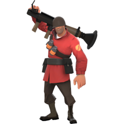

  

<h1 align="center">TF2 Re-Audio</h1>

Your voice. Your favorite classes.

Record your own versions of TF2 voice lines and hear them in the game.
Pick a class, record a line, and give it a try. No account needed.
Your recordings stay on your computer, and you can switch back to the original voices.

## Get started

1. **[Download ZIP](https://github.com/135Andres/TF2-Re-Audio/archive/refs/heads/main.zip)** and extract it into a folder.
2. **Open the app:**
   - **Windows 10/11 (64-bit):** double-click `TF2ReAudio.cmd`.
   - **Linux:** open a terminal in the extracted folder and run `sh tf2reaudio.sh`.
3. Your browser opens the app. Keep the launcher window open while using it.

You'll need **TF2 installed**, a **microphone**, and a browser with microphone support.
Windows can download Python on the first launch if needed. Linux needs Python 3.10 or newer.

## Make your first voice

1. Choose **Start solo** and confirm your TF2 folder.
2. Pick **Soldier** → **Start with MEDIC!** and allow microphone access.
3. Record, listen, and click **Save recording**.
4. Restart TF2, play as Soldier, and press **E** to hear it.

Later, you can set up **Apply changes** to try new recordings without restarting.
See the [short user guide](docs/README.md) when you need it.

<strong>Need a hand?</strong>

- **TF2 wasn't found?** Open **Setup & settings** and enter your **Team Fortress 2** folder.
- **Can't record?** Allow microphone access in your browser and check the selected microphone.
- **Still hearing the old voice?** Close and reopen TF2 after saving. If the app reports a file error, close TF2 and try **Apply changes** again.
- **Want the originals back?** Choose **Disable voices** in **Setup & settings**, then restart TF2. Your recordings stay saved.

For more help, see the [user guide](docs/README.md) or [report an issue](https://github.com/135Andres/TF2-Re-Audio/issues).

<strong>About this version</strong>

This is an early version for solo use. Group sharing is planned.
Voices have been tested in TF2 on Linux; Windows testing is still pending.

The app adds custom sound files to TF2's `tf/custom` folder.
Other players won't hear your recordings through this app.

Code: [MIT license](LICENSE). TF2 artwork and fonts belong to Valve; see [NOTICE](NOTICE).
This is a community project, not affiliated with Valve.

